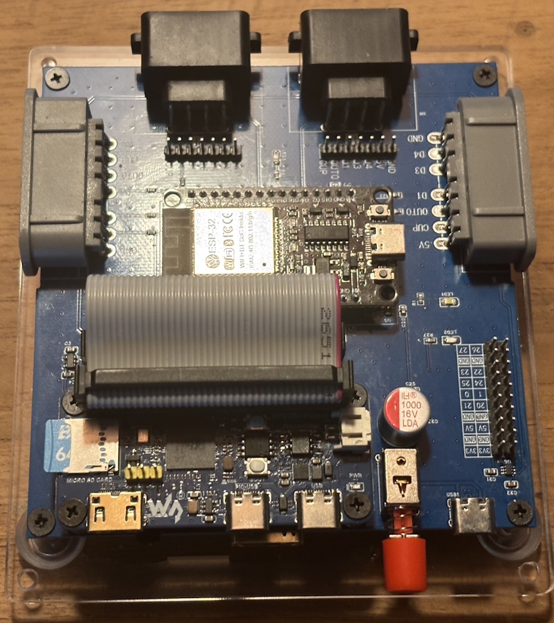
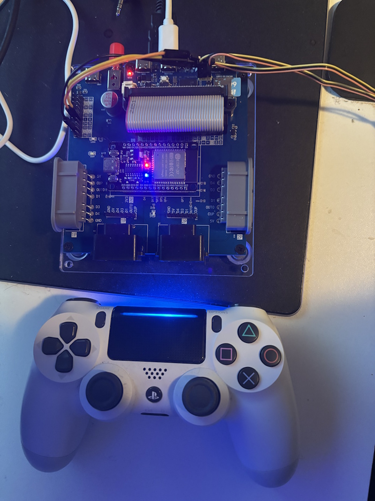
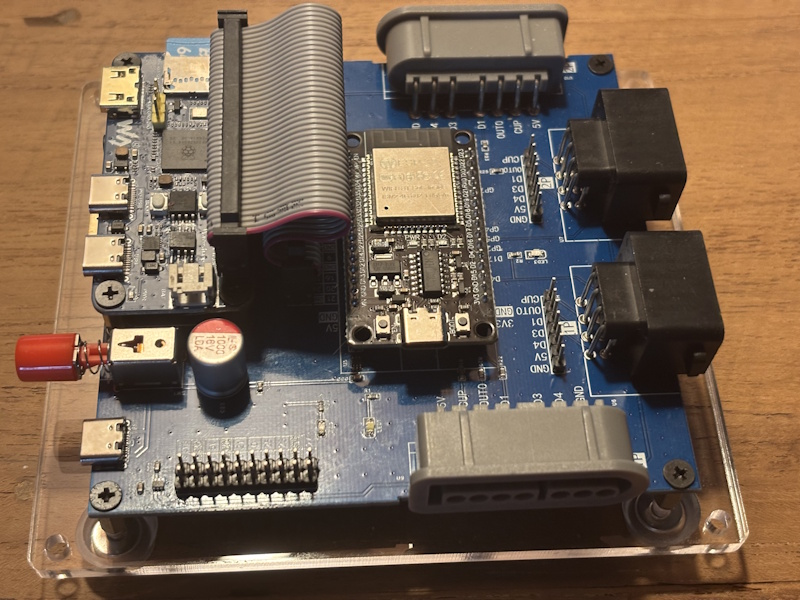
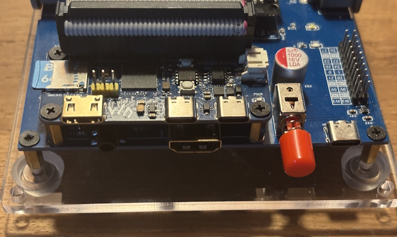

# pico-pcePlus

## Introduction

**pico-pcePlus** is a PC Engine / TurboGrafx-16 emulator for RP2350-based microcontrollers. It is built on the [pce-go](https://github.com/ducalex/retro-go) emulation core from retro-go by ducalex, integrated with the video, audio, menu, and SD card framework from [pico-infonesPlus](https://github.com/PicoPlus-devel/pico-infonesPlus).


> [!IMPORTANT]
> An **RP2350** board is required. The original RP2040 (Pico 1) is not supported.

This project is part of a family of Raspberry Pi Pico emulator projects:

- NES: [pico-infonesPlus](https://github.com/PicoPlus-devel/pico-infonesPlus)
- Sega Master System / Game Gear: [pico-smsplus](https://github.com/PicoPlus-devel/pico-smsplus)
- Game Boy / Game Boy Color: [pico-peanutGB](https://github.com/PicoPlus-devel/pico-peanutGB)
- Sega Mega Drive / Genesis: [pico-genesisPlus](https://github.com/PicoPlus-devel/pico-genesisPlus)

***

## What it emulates

- **HuCard ROMs** — Standard PC Engine / TurboGrafx-16 cartridge dumps (`.pce`) are loaded directly from the SD card.
- **SuperGrafx (SGX)** — SuperGrafx titles are recognised and dispatched to the second VDC. SuperGrafx support requires PSRAM, and the board must run at 384 MHz to reach the correct framerate and audio. This is only possible on configurations that use HSTX for video, such as the Adafruit Fruit Jam. On these boards, selecting a SuperGrafx game in the file browser switches the board to 384 MHz, and selecting another game switches it back; the board restarts each time. With **Overclock** on, the board stays at 384 MHz. PicoDVI configurations like the Waveshare RP2350 PiZero need an exact system clock of 252 MHz to produce 60 fps, which leaves no headroom to overclock for SuperGrafx. On those boards SuperGrafx games run at a reduced framerate and without audio.
- **CD-ROM²** — CD-ROM² and Super CD-ROM² games are supported, including CD-DA audio playback and ADPCM streaming. CD-ROM² playback requires PSRAM and a System Card BIOS supplied by the user.
- **Audio CDs** — Regular music CDs can be played with the CD player built into the System Card BIOS. Put a CUE/BIN or CHD image of a music CD on the SD card and start it like a CD game: the track list appears and playback, track skip, pause and the level meters all work.
- **Save states** — Manual save and load slots are available through the in-game menu. An optional auto-save mode stores a state when the game exits and offers to resume it the next time the same ROM is launched. State files are stored on the SD card under `/savestates/PCE/<CRC32>/`.
- **USB drive mode** — The SD card can be shown on a PC over USB from the settings menu, so files can be copied without removing it from the console. See [USB drive mode](#usb-drive-mode).
- **Backup RAM (BRAM)** — CD-ROM² games that use the System Card's BRAM (for in-game save data) have it persisted automatically alongside the save states.

| | |
|---|---|
|  |  |
|  |  |
|  |  |


***

## CD-ROM² disc formats

Two disc-image formats are accepted:

- **CUE/BIN** — Uncompressed CD images. This is the recommended format.
- **CHD** — Compressed disc images (MAME's CHD format). CHD images are decompressed sector-by-sector at run time and are therefore generally slower than CUE/BIN. They are useful when SD card space is limited; otherwise CUE/BIN is preferred.

Each disc image (and its associated tracks for CUE/BIN) should be placed in its own folder on the SD card.

> **Note on SD card speed:** CD playback is sensitive to SD card speed, especially when using CHD images that must be decompressed in real time. v0.2 reduced the impact considerably, but a slow or aging card can still cause occasional stutter or audio glitches; a faster card resolves it.

### Setup Overview

1. Prepare an SD card formatted as FAT32 or exFAT
2. Transfer ROM files to the card, preferably in /roms/PCE and CD games in /roms/PCE/CD (subdirectory organization is supported).
3. Optionally include [metadata files](#metadata) for game information
4. Insert the SD card into the device
5. Use the menu to browse, select, and play games. Save data is automatically persisted to the SD card. The last 20 games that were started are kept in a [recently played list](#recently-played-games), one button press away in the menu.

***

## Known issues

- **Ginga Fukei Densetsu Sapphire** stutters during gameplay: the picture updates at
  roughly half rate in busy scenes. Emulation keeps full speed and audio is
  unaffected. The board needs more time per frame than one frame allows, and the
  emulated CPU accounts for the difference. Overclocking to 384 MHz improves matters
  but does not remove it. No other CD game is known to be affected. See
  [issue #17](https://github.com/PicoPlus-devel/pico-pcePlus/issues/17).

***

## Hardware requirements

The emulator runs on RP2350-based boards in two configurations:

- **RP2350 without PSRAM** — Supports HuCard ROMs, save states, and metadata display.
- **RP2350 with PSRAM** — In addition to the above, enables SuperGrafx titles, CD-ROM² playback (CUE/BIN or CHD), Backup RAM persistence, and audio recording.

For board-by-board wiring, supported display modes, and which UF2 file to flash, refer to the [pico-infonesPlus documentation](https://github.com/PicoPlus-devel/pico-infonesPlus#setup). The set of supported boards and their pinouts is identical between the two projects.

This includes the [Olimex RP2040-PICO-PC](https://www.olimex.com/Products/MicroPython/PICO/RP2040-PICO-PC/) with a Raspberry Pi Pico 2, which plays sound through HDMI and its audio jack at the same time; see [Olimex RP2040-PICO-PC](https://github.com/PicoPlus-devel/pico-infonesPlus#olimex-rp2040-pico-pc).

The [Pico Computer 3](https://github.com/UKTailwind/Pico-Computer-3) is supported as well. It has PSRAM on the board, and up to two NES or SNES controllers and a Wii Classic controller connect to its I/O header; see [Pico Computer 3](https://github.com/PicoPlus-devel/pico-infonesPlus#pico-computer-3). Support for this board is new, and its pin assignment may still change.

The [PCB for the Waveshare RP2350-PiZero](https://github.com/PicoPlus-devel/pico-infonesPlus#pcb-with-waveshare-rp2350-pizero), designed by Liu Szuping ([szuping](https://github.com/szuping)), is supported as well. Video goes through the HDMI port of the PCB, and sound through HDMI, or through the audio jack with *External Audio* in the settings menu. Up to two NES or SNES controllers connect to the controller ports of the PCB, or Bluetooth controllers through an ESP32 module running [BlueRetro](https://github.com/darthcloud/blueretro) in its socket. PSRAM is optional and has to be soldered onto the RP2350-PiZero. With *Overclock* on, some TVs and monitors lose the picture for a few seconds at a time during CD-ROM² games, while others show it without interruption; this is a limitation of the RP2350-PiZero at 384 MHz. At the default 252 MHz, and with HuCard games, this does not occur. The PCB design is not yet available.

A board and its breakouts can also be built into a finished little console on one of the [custom PCBs](#custom-pcbs).

***

## Custom PCBs

Four community PCB designs turn a supported board and its breakouts into a small console. Nothing changes in the firmware: flash the binary for that configuration. Parts lists, ordering instructions, assembly notes, the pin assignment, the 3D-printed cases and the older design versions are described in the [PCB README](https://github.com/PicoPlus-devel/pico_shared/blob/main/PCB/README.md). The Gerber files are attached to every [release](https://github.com/PicoPlus-devel/pico-pcePlus/releases/latest) of this project.

| Design | Picture | Controller ports | Board it carries | Build | Designed by |
| --- | --- | --- | --- | --- | --- |
| [PicoNES v2.6](#picones-pcb) | <br><sub>See note</sub> | 2 × NES | Pico 2, Pico 2 W or Pimoroni Pico Plus 2 | `-c2` | [John Edgar Park](https://twitter.com/johnedgarpark) |
| [PicoNES v2.8](#picones-pcb) | <br><sub>See note</sub> | 2 × SNES | Pico 2, Pico 2 W or Pimoroni Pico Plus 2 | `-c2` | [John Edgar Park](https://twitter.com/johnedgarpark) |
| [PicoNES Mini](#picones-mini-pcb) |  | 2 × NES | Waveshare RP2350-Zero | `-c6` | [Gavin Knight](https://github.com/DynaMight1124) |
| [PicoNES Micro](#picones-micro-pcb) |  | None, USB controller only | Waveshare RP2350-USB-A | `-c9` | [Gavin Knight](https://github.com/DynaMight1124) |

> [!NOTE]
> The PicoNES v2.6 and v2.8 are shown with a Pimoroni Pico Plus 2. A Raspberry Pi Pico 2 or Pico 2 W can also be fitted.

A fifth design, the [PCB for the Waveshare RP2350-PiZero](https://github.com/PicoPlus-devel/pico-infonesPlus#pcb-with-waveshare-rp2350-pizero) by Liu Szuping, is supported by the emulator, but the design is not yet available.

|  |  |
|:--:|:--:|
|  |  |

The PicoNES and PicoNES Mini both have two controller ports, so the second player of a two-player PC Engine game has a pad; the PicoNES Micro is a single-controller design.

> [!IMPORTANT]
> The PicoNES also fits an original RP2040 Pico, and the PicoNES Mini exists in an RP2040-Zero flavour. Neither is of use here — this emulator requires an RP2350.

Of these boards, only the Pimoroni Pico Plus 2 on the PicoNES has PSRAM. That is what CD-ROM² games, SuperGrafx titles and audio recording need; on a Pico 2, a Waveshare RP2350-Zero or a Waveshare RP2350-USB-A the emulator plays HuCard ROMs.

> [!NOTE]
> Sellers on AliExpress have copied the PicoNES design and sell ready-made boards. For questions about those, contact the seller.

### PicoNES PCB

The PicoNES PCB carries the microcontroller board, the DVI and microSD breakouts and two controller ports. It comes in two versions, which differ only in the controller ports: **v2.6** with NES controller ports and **v2.8** with SNES controller ports.

A Pico 2 or Pico 2 W can be soldered flat onto the PCB or mounted on male pin headers. A [Pimoroni Pico Plus 2](https://shop.pimoroni.com/products/pimoroni-pico-plus-2?variant=42092668289107) must be mounted on pin headers, because the SP/CE connector on its back prevents it from lying flat. Optional female socket headers, soldered into the PCB, let the board be plugged in and swapped without desoldering.

Controllers on the two GPIO controller ports:

- **v2.8:** original SNES controllers plug in directly.
- **v2.6:** NES controllers plug in directly. A plain NES controller has no Button3, so it cannot open the [recently played list](#recently-played-games) directly; use the settings menu entry instead. A SNES controller works as well and is the better choice, but needs a [SNES-to-NES adapter cable](https://nl.aliexpress.com/item/1005007923169070.html) or [one you make yourself](http://www.neshq.com/hardmods/snes_to_nes_controller.txt), one per port.

Populate both ports to give player 2 a pad.

The parts lists and assembly notes are in the PCB README: [PicoNES v2.6](https://github.com/PicoPlus-devel/pico_shared/blob/main/PCB/README.md#picones-v26-nes-controller-ports) and [PicoNES v2.8](https://github.com/PicoPlus-devel/pico_shared/blob/main/PCB/README.md#picones-v28-snes-controller-ports).

| NES controller ports (v2.6) | SNES controller ports (v2.8) |
| --------------------------- | ---------------------------- |
|  |  |

#### Which binary to flash

`picopcePlus_AdafruitDVISD_pico2_arm.uf2`, for the Pico 2, the Pico 2 W and the Pimoroni Pico Plus 2 alike. The Pimoroni Pico Plus 2 needs no separate build: the emulator reads the real flash size from the chip at boot and detects PSRAM at runtime, so the same image adapts to whichever board is plugged in.

#### 3D printed case

Gavin Knight ([DynaMight1124](https://github.com/DynaMight1124)) designed an NES-like case for the v2.6 PCB: [thingiverse.com/thing:6689537](https://www.thingiverse.com/thing:6689537). It does not fit the v2.8 PCB. Two top covers are available, one with a button that presses the BOOTSEL button for firmware updates and one without. All parts are shown in the [PCB README](https://github.com/PicoPlus-devel/pico_shared/blob/main/PCB/README.md#3d-printed-case). For questions about the case, please contact the designer on the Thingiverse page.

> [!IMPORTANT]
> If the board is mounted with male headers, download the **latest** top cover. Headers raise the board, and only the newest cover leaves room for the USB cable — the older ones assume a Pico soldered flat onto the PCB.

| Top cover | Base |
| --------- | ---- |
|  |  |

### PicoNES Mini PCB

The PicoNES Mini, by Gavin Knight ([DynaMight1124](https://github.com/DynaMight1124)), is a smaller PCB for a Waveshare RP2350-Zero, with two NES controller ports. It uses cheaper components that are harder to solder, and is recommended only for builders with good soldering skills.

Flash `picopcePlus_WaveShareRP2350ZeroWithPCB_arm.uf2`. The RP2350-Zero has no PSRAM, so this build plays HuCard ROMs.

The parts list and build instructions are in the [Instructables guide, step 1](https://www.instructables.com/PicoNES-RaspberryPi-Pico-Based-NES-Emulator/#step1). See also [PicoNES Mini](https://github.com/PicoPlus-devel/pico_shared/blob/main/PCB/README.md#picones-mini-waveshare-rp2040-zero--rp2350-zero) in the PCB README. The 3D-printed case is available on [Thingiverse](https://www.thingiverse.com/thing:7041536).


### PicoNES Micro PCB

The PicoNES Micro, by Gavin Knight ([DynaMight1124](https://github.com/DynaMight1124)), is a very small PCB for the Waveshare RP2350-USB-A, for one player with a USB controller. It uses 0603-size SMD components and requires micro-soldering skills.

Flash `picopcePlus_WaveShare2350USBA_arm_piousb.uf2`. The game controller plugs into the USB-A port; the USB-C port is for power and for flashing the firmware. The RP2350-USB-A has no PSRAM, so this build plays HuCard ROMs, and the driver recognises only one USB controller, so two-player games cannot be played on it.

The parts list, build instructions and case are in the [Instructables guide, steps 2 and 3](https://www.instructables.com/PicoNES-RaspberryPi-Pico-Based-NES-Emulator/#step2). See also [PicoNES Micro](https://github.com/PicoPlus-devel/pico_shared/blob/main/PCB/README.md#picones-micro-waveshare-rp2350-usb-a) in the PCB README.


***

## CD-ROM² BIOS

CD-ROM² games require a System Card BIOS to boot. The BIOS file must be supplied by the user; it is not distributed with the emulator.

### Placement

- Create a `/bios/` folder in the root of the SD card and place one or more BIOS files there (with a `.pce` extension, or named `cd_bios.rom`).
- Alternatively, place a BIOS file alongside a disc image; this takes precedence over `/bios/` and allows a per-game override.

The emulator identifies BIOS files by CRC32 and, when several are available, selects the most capable variant automatically. For maximum compatibility the **Super CD-ROM System v3.0 (JP)** or the **Arcade Card Pro (JP)** BIOS is recommended.

> [!NOTE]
> Without a recognised BIOS file in `/bios/` (or alongside the disc image), CD-ROM² games will fail to load.

***

## Metadata

The emulator can display box art and a short text description for each ROM when a metadata pack is present on the SD card. With the pack installed, pressing **START** on a ROM in the file browser displays its metadata; the screensaver also shows random box art.

A metadata pack can be downloaded from the [releases page](https://github.com/PicoPlus-devel/pico-pcePlus/releases) and extracted to the root of the SD card. It is installed under:

```
/metadata/PCE/
├── images/   (box art, named by ROM CRC32)
└── descr/    (text descriptions, named by ROM CRC32)
```


***

## Controls

The emulator presents the PC Engine controller mapping on any connected USB controller, NES/SNES controller (directly wired), or Wii Classic Controller (via I²C). Supported USB devices include Sony DualShock 4 / DualSense, Sega Genesis Mini 1 and 2, Retro-bit 8-button Genesis-USB, PlayStation Classic, USB keyboards, and XInput-compatible controllers (Xbox 360, Xbox One, 8BitDo, and similar).

The PC Engine controller has a D-pad, two action buttons (**I** and **II**), and two system buttons (**SELECT** and **RUN**).

During gameplay, **SELECT + RUN** opens the in-game settings menu, from which the game can be quit or reset, save states managed, and settings such as screen mode, framerate overlay and audio output changed. See [Settings menu](#settings-menu) for the full list.

In the file browser, Button2 opens a folder or starts a game, Button1 goes back to the parent folder, START shows metadata and box art, SELECT opens the [settings menu](#settings-menu), and Button3 opens the [recently played list](#recently-played-games). Button3 is X on a SNES or Wii Classic pad, Y on XInput, Triangle on PlayStation and C on Genesis; a plain NES controller has no Button3.

Two-player games are supported. Without a USB controller, the two GPIO controller ports are player 1 and player 2. With a USB controller connected, that pad becomes player 1 and either GPIO port (or a Wii Classic Controller) drives player 2.

***

## Recently played games

The menu keeps a list of the **last 20 games that were started**, most recent first. Open it with **Button3** in the file browser, or with the **Recently played** entry at the top of the [settings menu](#settings-menu). That entry is only present when the settings menu is opened from the file browser, not from inside a running game — which is also the route for pads without a Button3.

In the list:

| Button | Action |
| ------ | ------ |
| UP/DOWN | Select a game. |
| Button2 | Start the highlighted game. |
| Button1 | Close the list and return to the file browser. |
| SELECT | Remove the highlighted game from the list. Asks for confirmation first. This only removes the entry; the file on the SD card is left alone. |
| START | Show [metadata](#metadata) and box art (when available). |

Games are added automatically when they are started, so nothing has to be enabled. HuCard, SuperGrafx and CD games all appear in the list; starting a game that is already in it moves it back to the top. The list closes by itself after a minute without input.

The list is kept in **`/recent_PCE.txt`** in the root of the SD card, as plain text with one game per line. It survives a reboot and can be read, edited or deleted on a PC. Deleting the file simply empties the list, and a damaged file is treated as an empty list — unlike the settings file, nothing else is reset. Each emulator running under [pico-bootLoader](https://github.com/PicoPlus-devel/pico-bootLoader) keeps its own list.

If a game was moved, renamed or deleted on the SD card in the meantime, the list says so instead of starting it. Use SELECT to remove such an entry.

On boards **without** PSRAM, one entry can be tagged **[READY]**. That is the game whose ROM is currently written to flash, which is the one that starts without waiting for the flashing step. As of v0.4 a ROM that is already in flash is not written again, so restarting that game is immediate.

***

## Settings menu

The settings menu is opened with SELECT from the file browser, or with SELECT + RUN while a game is
running. Not every entry is available on every board or in every situation. The entries are listed in
the order they appear on screen.

| Setting | Description |
| ------- | ----------- |
| Recently played | Open the list of the [last 20 games that were started](#recently-played-games) and start one of them. File browser only, not available in-game. |
| Quit game | Leave the game and return to the file browser. For CD-ROM² games the Backup RAM (BRAM) is written to the SD card here, and when auto save is enabled a save state is stored as well. In-game only. |
| Reset game | Reset the running game. In-game only. |
| Return to boot loader | Go back to the emulator picker. Only present in [pico-bootLoader](https://github.com/PicoPlus-devel/pico-bootLoader) builds. |
| Save/Load State | Save or load the game state in one of five slots or the quick save slot, and switch automatic saving on exit and loading on start on or off. In-game only. |
| Screen Mode | Cycle the screen modes: 1:1 or 8:7 pixel aspect ratio, each with or without scanlines. On HSTX boards, games that use a resolution wider than 256 pixels are always shown 1:1. |
| Scanline Type | Simple or LCD style scanlines. HSTX boards only. |
| Framerate Overlay | Show the frames per second on screen. On HSTX boards the number of video resyncs is shown next to it. |
| Display Mode | HDMI or DVI output. HSTX boards only. |
| External Audio | Route audio to the I²S/line-out output instead of HDMI. Only on boards with such an output. Selecting DVI as Display Mode enables this automatically, because DVI carries no audio. |
| Menu Font Color / Menu Font Back Color | Menu colours (0-63). The colour palette is shown while one of these two entries is selected. |
| Overscan fix in menu | For TVs that cut off the edges of the picture. **Off** (default), **Rows** leaves the top and bottom text rows of the menus blank, **Rows & columns** also leaves the first and last columns blank. The effect is shown while the setting is changed. It applies to the menus only, not to the game picture. |
| Fruit Jam VU Meter | Let the NeoPixel LEDs follow the audio level. Fruit Jam only. |
| Fruit Jam Volume Control | Volume of the built-in speaker and the audio jack (-63 to +23 dB). Fruit Jam only. |
| Overclock | Raise the CPU clock from 252 MHz to 384 MHz. The board reboots to apply the change. Required for SuperGrafx games to run at full speed with audio. HSTX boards only. File browser only, not available in-game. |
| Controller Test | Show a gamepad graphic that follows the controller a button was last pressed on, plus a list of connected input sources. Useful for checking wiring and button mappings. Hold SELECT + UP for 2 seconds to exit. |
| Enter BOOTSEL Mode | Reboot into BOOTSEL so new firmware can be flashed. |
| USB Drive Mode | Show the SD card on a computer as a USB drive, so games can be added or removed without taking the card out. See [USB drive mode](#usb-drive-mode). File browser only, not available in-game. |

> [!NOTE]
> Changes are only applied when **SAVE** is selected. **CANCEL** discards them, **DEFAULT** restores the default values. Press SELECT on any setting to jump straight to the SAVE/CANCEL/DEFAULT row.

***

## USB drive mode

USB drive mode presents the SD card to a computer as a USB mass storage device, so games can be added or
removed without taking the card out of the console. Connect the console to the computer, open the
[settings menu](#settings-menu) with SELECT from the game list and choose **USB Drive Mode**. The card
appears on the computer as a removable drive.

The entry is only offered when the settings menu is opened from the game list. It is not available while
a game is running: the running game holds its save files open and its ROM is mapped out of flash, and
letting the computer rewrite the card underneath that would corrupt both.

When you are finished, eject the drive on the computer. The console notices this and leaves USB drive
mode by itself. Pressing B on the console leaves as well, for when no computer is attached. The game
list is re-read on the way out, so files added from the computer appear without having to restart.

> [!NOTE]
> Transfers are slow. The console is a USB full-speed device and reaches the card a sector at a time
> over SPI, so copying is far slower than reading the card in a card reader. USB drive mode is meant
> for adding or replacing a few games. For filling a card, or for copying a large amount of data, take
> the card out and use a card reader.

Behaviour depends on where controllers are connected on your board.

| Board | Behaviour |
| ----- | --------- |
| Controllers on a separate USB port (boards built with PIO USB, such as the Fruit Jam) | The console's own USB port is free, so controllers keep working and the screen stays on. The menu returns to the game list when you are done. |
| Controllers on the console's own USB port | That port is the one connected to the computer, so a USB controller cannot be used while the card is mounted. Press B on a controller in the NES port, or eject the drive on the computer. The console restarts afterwards. |

***

## Building from source

### Prerequisites

- The [Raspberry Pi Pico SDK](https://github.com/raspberrypi/pico-sdk), with the `PICO_SDK_PATH` environment variable set.
- CMake 3.13 or later.
- The ARM GCC toolchain (and, for RISC-V builds, the RISC-V toolchain in `$PICO_SDK_PATH/toolchain/RISCV_RPI_2_0_0_2/bin`).
- `picotool` on the `PATH`.

### Clone and build

```bash
git clone --recurse-submodules https://github.com/PicoPlus-devel/pico-pcePlus.git
cd pico-pcePlus
```

Run `./bld.sh -h` to see the available build options for a single configuration, or `./buildAll.sh` to build every supported configuration and collect the resulting UF2 files in the `releases` folder. For the mapping between configuration numbers and specific boards, consult the [pico-infonesPlus](https://github.com/PicoPlus-devel/pico-infonesPlus) documentation.

***

## Flashing

1. Hold the **BOOTSEL** button on the RP2350 board while connecting it to a computer via USB.
2. The board mounts as a USB mass-storage device.
3. Copy the appropriate `.uf2` file to the device.
4. The board reboots automatically and starts the emulator.

***

## License

This project is licensed under the GNU General Public License v3.0. See the [LICENSE](LICENSE) file for details.

***

## Credits

### Emulation cores and frameworks

- [pce-go](https://github.com/ducalex/retro-go) — PC Engine / TurboGrafx-16 emulation core, by ducalex (part of retro-go).
- [pico-infonesPlus](https://github.com/PicoPlus-devel/pico-infonesPlus) — shared video, audio, menu, and SD card infrastructure, by Frank Hoedemakers.
- [Mesen2](https://github.com/SourMesen/Mesen2) — used as a reference for the PC Engine CD ADPCM decoder port.

### Video and display

- [PicoDVI](https://github.com/Wren6991/PicoDVI) — DVI output library by Wren6991.
- [pico_lib](https://github.com/shuichitakano/pico_lib) — PicoDVI audio support by [Shuichi Takano](https://github.com/shuichitakano).
- [pico_hdmi](https://github.com/fliperama86/pico_hdmi) — HSTX HDMI/DVI driver with audio by [fliperama86](https://github.com/fliperama86).

### Disc images, storage, and memory

- [libchdr](https://github.com/rtissera/libchdr) — CHD disc-image decompression, with its bundled miniz, LZMA SDK, and zstd dependencies.
- [pico_fatfs](https://github.com/elehobica/pico_fatfs) — FatFs SD card driver by [elehobica](https://github.com/elehobica).
- [PicoPlusPsram](https://github.com/AndrewCapon/PicoPlusPsram) — PSRAM driver by [AndrewCapon](https://github.com/AndrewCapon).
- [lwmem](https://github.com/MaJerle/lwmem) — lightweight memory allocator by [MaJerle](https://github.com/MaJerle).

### USB and controllers

- [TinyUSB](https://github.com/hathach/tinyusb) — USB host stack.
- [Pico-PIO-USB](https://github.com/sekigon-gonnoc/Pico-PIO-USB) — software USB host implementation on PIO, by [sekigon-gonnoc](https://github.com/sekigon-gonnoc), used to expose a second USB port for controllers.
- [tusb_XInput](https://github.com/Ryzee119/tusb_XInput) — XInput controller driver by [Ryzee119](https://github.com/Ryzee119).
- NES gamepad and Wii Classic Controller support contributed by [PaintYourDragon](https://github.com/PaintYourDragon) and [Adafruit](https://github.com/adafruit).

### Hardware and assets

- PCB design by [John Edgar Park](https://twitter.com/johnedgarpark).
- Additional PCB design and 3D-printable cases (for both PCBs and the WaveShare RP2040/RP2350-PiZero) by [Gavin Knight](https://github.com/DynaMight1124).
- Metadata files provided by [Gavin Knight](https://github.com/DynaMight1124), based on [Ducalex's retro-go-covers](https://github.com/ducalex/retro-go-covers).
- Olimex RP2040-PICO-PC support, including sound through its audio jack, by [DnCraptor](https://github.com/DnCraptor).
- Pico Computer 3 support by [javavi](https://github.com/javavi).
- PCB design for the Waveshare RP2350-PiZero by Liu Szuping ([szuping](https://github.com/szuping)).

### Contributions and assistance

- [Anthropic Claude (Opus 4.6 and 4.7)](https://www.anthropic.com/claude/opus) assisted with the PSG rewrite, the ADPCM decoder port, CHD integration, SuperGrafx work, and general bug fixes.
